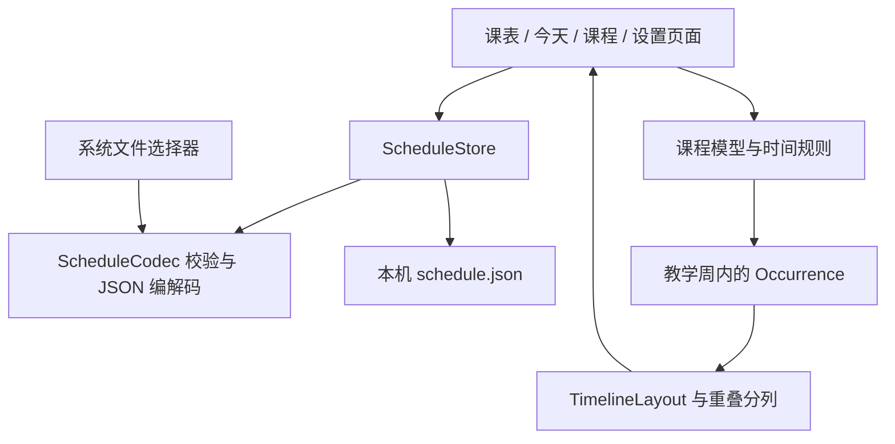

# 模块与数据规则

梅课的课表保存在本机；课程讨论和组队通过 HTTPS 连接 Python / SQLite 后端。Flutter 页面负责交互，Dart 模型负责时间和课程规则，文件存储负责离线课表持久化；安卓与 iOS 复用这些实现。

## 一门课程可以有多个时间

`ScheduleData` 包含学期 `Semester` 和课程列表 `Course`。一门 `Course` 有共享的名称、教师、地点、颜色与备注，以及两种安排：

| 模型 | 用途 | 规则 |
| --- | --- | --- |
| `WeeklyMeeting` | 每周常规上课 | 星期、起止节次、起止教学周、每周 / 单周 / 双周、可选教师和地点覆盖 |
| `ExtraMeeting` | 指定周实验、补课等 | 教学周、星期、全天或自定义时刻、可选名称 / 教师 / 地点 / 备注 |

新增常规安排时同时选择周一、周四，会创建两条独立的 `WeeklyMeeting`。两条可以再分别编辑，不需要复制整门课程。额外安排独立于课程的常规单双周规则，例如双周课程也可以在第 3 周周日安排全天实验。

空的教师 / 地点覆盖会继承课程信息。`Occurrence` 是某一教学周实际展开后的课程事件，用于显示、排序、时间冲突和倒计时；它不单独保存到文件中。

## 时间、课间与冲突

`SchoolClock` 按 UTC+8 的学校时间计算日期、星期与教学周。第 1 周起点对齐开学日期所在周的周一，单双周从教学周编号判断。

学校默认作息为 13 节，各节 45 分钟。设置允许调整节次；相邻节次的间隔自动生成课间、午休或晚休。`TimelineLayout` 压缩休息区间，在竖屏尽量完整展示整周；小屏和横屏可以滚动。节次前后的额外安排也会扩展时间轴，全天事件在独立区域展示。

普通连堂课程的实际占用时间由每一节组成，不把中间休息算作上课冲突。额外安排按连续时段计算，全天安排占用所在日。区间采用前闭后开，某安排结束时刻与另一安排开始时刻相同不算冲突。重叠卡片通过 `OccurrenceLane` 并排展示。

「今天」每秒更新一次。普通课程显示距离当前这一节下课的时间；额外定时安排显示距离本次结束的时间；全天安排不生成下课倒计时。下课后的连堂间隔显示课间状态。

## 本地存储与备份

数据路径为应用私有的 `Application Support/KeJian/schedule.json`。各平台目录由 `path_provider` 提供，不能跨 App 自动访问私有目录。

保存流程为：复制草稿 → 业务校验 → JSON 编码 → 同目录临时文件写入并刷新 → 文件替换 → 更新内存并通知页面。读取失败时保留原始文件，阻止普通保存；恢复有效备份前，会另存损坏原文件副本。

导入 / 导出由 `file_picker` 调用系统文件选择器。导入以有上限的流读取文件，校验通过后再提示用户确认替换。备份上限为 2,000,000 字节。

当前沿用 SwiftUI 版的 JSON `version: 1`。测试样本验证了 20 周展开结果，以及 Swift → Flutter → Swift 往返。未来改变格式时需增加明确的迁移流程，不能直接覆盖旧版本约定。

## 后续扩展位置

`DiscussionClient` 与 `TeamClient` 复用 HTTPS 昵称身份，学校数据来源和课程目录采用独立模型，不把服务器响应直接塞进现有 `Course` 备注。`server/team_matching` 是不依赖数据库的纯规则模块，问卷、矩阵和权重使用版本配置；`server/teams.py` 负责事务、身份权限和推荐服务。具体模型、边界和接口见 [课程组队实现](TEAM_MATCHING_IMPLEMENTATION.md)。

小组件、实时活动或悬浮窗还需要各平台集成；Flutter 共用课表计算并不代表这些系统能力已经实现。当前讨论身份未绑定学号，组队教学班归属由用户主动确认，不能视为已验证的学籍。课表尚未做云同步。
