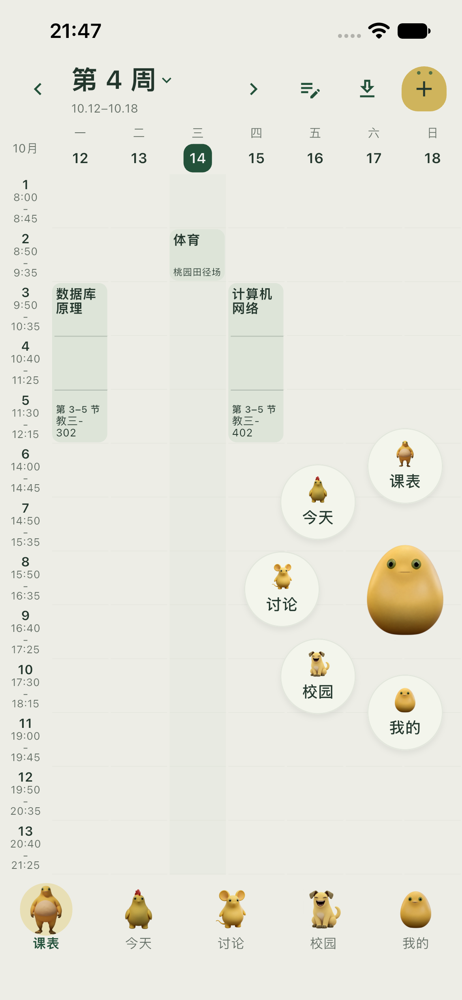
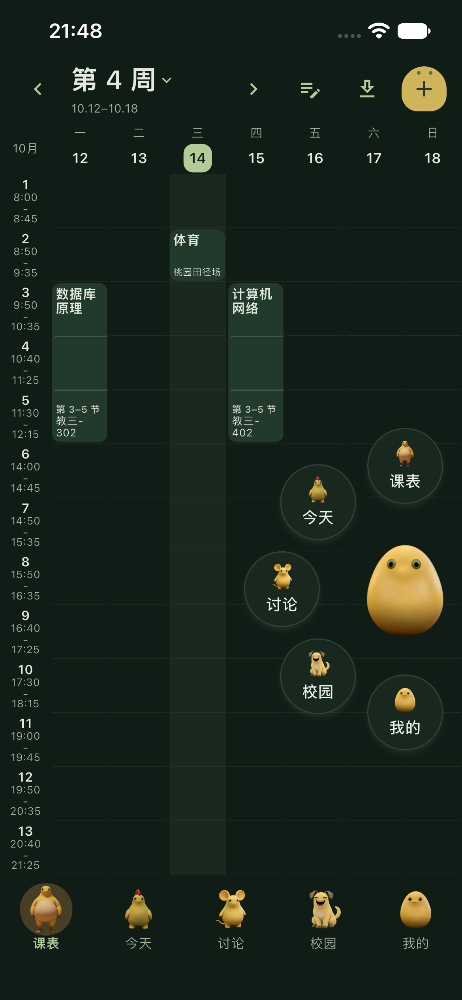
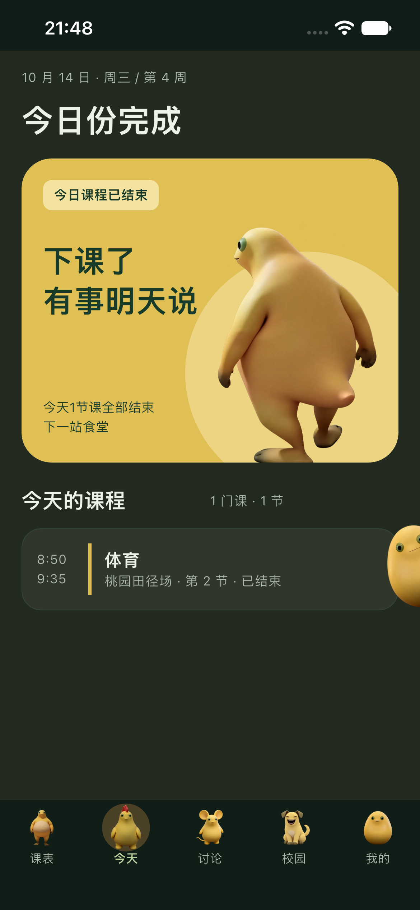

# 奶家日常主题

在「我的 → 外观 → 主题」中选择「奶家日常」。跟随系统 / 浅色 / 深色是独立的外观设置，奶蛋宠物和角色动效也可以分别关闭。

## 最终表现

- 五个底部入口使用奶蛙、奶鸡、奶鼠、奶狗、奶蛋。课表保留整周布局，并用亮边和奶蛋探头标识正在上的课程，添加按钮带有角色眼睛。
- 「今天」根据实际课程状态显示上课、待上课、课间、无课及全部结束的黄色卡片。上课卡片显示本节倒计时和连堂课结束时间；完成卡片的背身奶蛙向左留出空间。
- 讨论入口使用横幅与五只奶动物围坐讨论的插画；校园入口分别使用耕地奶鸡、黑板奶鼠、挂历奶蛋，以及坐在讲座椅上认真听讲、拿笔记本记笔记的奶蛙。素质讲座介绍卡沿用听讲奶蛙插画。
- 奶蛋平时斜靠在屏幕边缘。展开时仍靠近边缘，五个圆形气泡位于屏幕内侧的半圆；左侧吸附时镜像排列。点击气泡跳转到对应主页，点击空白或奶蛋收起菜单。
- 奶蛋先站稳，再通过连续绘制的嘴巴形状表现「安 → 短暂收口 → 迪～」。身体纹理固定，结束后静止；系统减弱动态或关闭角色动效时直接展开。
- 奶蛋可以上下、左右拖动，拖动时保持直立。释放位置距离左、右边缘不超过 48 点时吸附到对应边框；否则平滑回到本次拖动起点。键盘出现时隐藏，关闭键盘后保留原位置。
- 从课程编辑页使用快捷导航时，未保存修改仍需确认。编辑初始快照在打开页面时创建，避免第一次离开时错误地把已修改内容当作原始内容。

## 实现入口

| 文件 | 职责 |
| --- | --- |
| `lib/ui/appearance.dart` | 主题、显示模式及动效 / 宠物偏好，兼容既有外观文件 |
| `lib/ui/nai_family.dart` | 奶动物组件、底部导航、添加按钮和当前课程探头布局 |
| `lib/ui/nai_today.dart` | 使用实际课程与时间生成今日状态卡 |
| `lib/ui/nai_egg_pet.dart` | 连续口型绘制、边框吸附、半圆菜单与手势 |
| `lib/app.dart` | 全局宠物层、底部栏共享导航入口、详情返回与编辑确认 |
| `assets/nai-family/` | 应用使用的 WebP 角色与插画；嘴巴由 Flutter 绘制 |
| `test/nai_family_test.dart`、`test/nai_pet_test.dart` | 状态卡、布局、口型绘制、手势、导航及偏好验证 |

## 验证

1.6.5（25）已完成 `flutter analyze`（无问题）和 `flutter test`（152 项通过）。iOS 模拟器检查了浅 / 深色、左右半圆、拖动时直立、两段口型与今日完成卡片；iPhone release 已签名、安装并启动，更新前后本地课表和登录数据保留。

本次主题尚未进行 Android 真机验证。应用业务与备份格式沿用既有实现，外观偏好仍单独保存。

## 演示截图

截图来自 iOS 模拟器，课程为演示数据。

| 浅色半圆菜单 | 深色半圆菜单 | 今日完成卡片 |
| --- | --- | --- |
|  |  |  |
